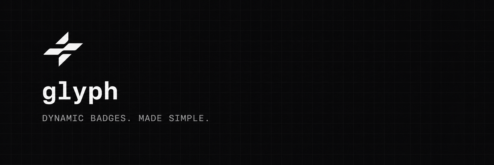

**Before anyone reaches your docs, they land on your README, the front door of every open-source project. **glyph** makes that first impression count: badges, charts, headers, and sponsor walls components. A [shields.io](https://shields.io) alternative.**

  
  

See [`BADGES.md`](BADGES.md) for every preset badge and copyable Markdown snippet.
See [`docs/graphs/README.md`](docs/graphs/README.md) for GitHub Pages graph assets.
See [`STATUS.md`](STATUS.md) for the reusable dynamic status badge format.

## GitHub Pages

The project site is deployed automatically from `docs/` by
[`.github/workflows/pages.yml`](.github/workflows/pages.yml) whenever `main`
changes. In the repository settings, set **Pages → Build and deployment →
Source** to **GitHub Actions** once, then the site will be available at
`https://benjamin-blanke.github.io/glyph/`.
